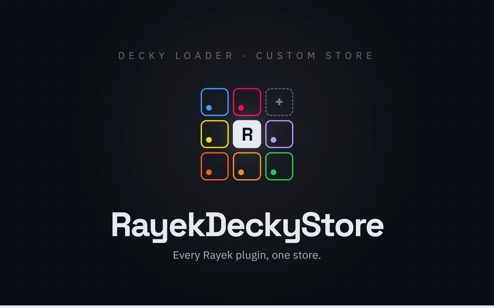
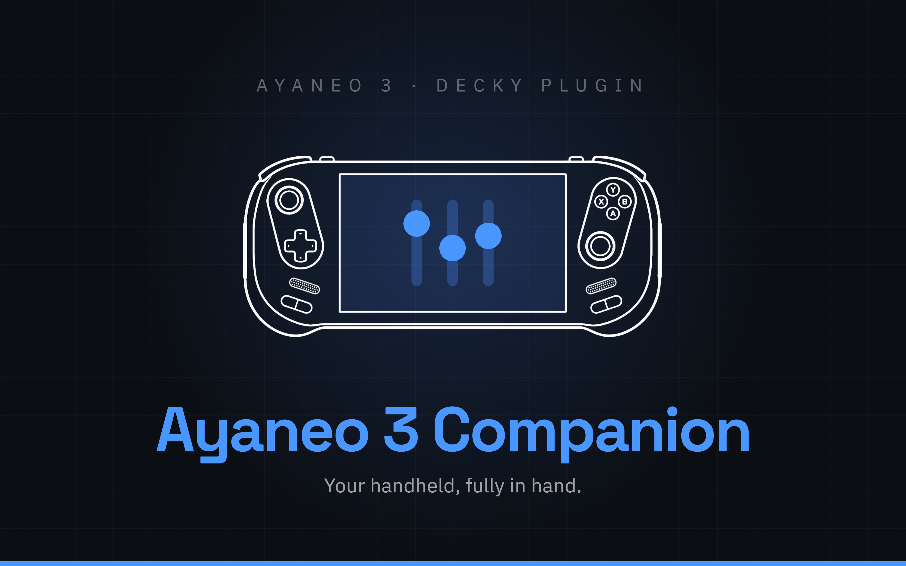
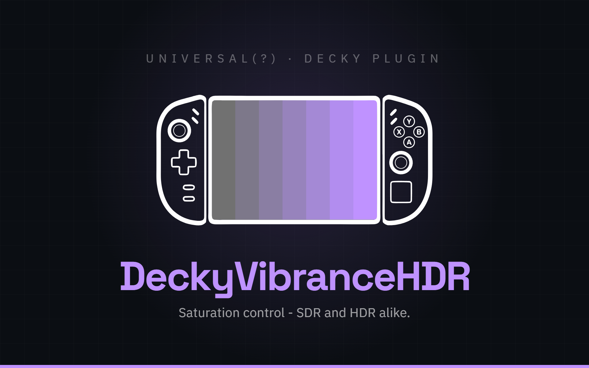
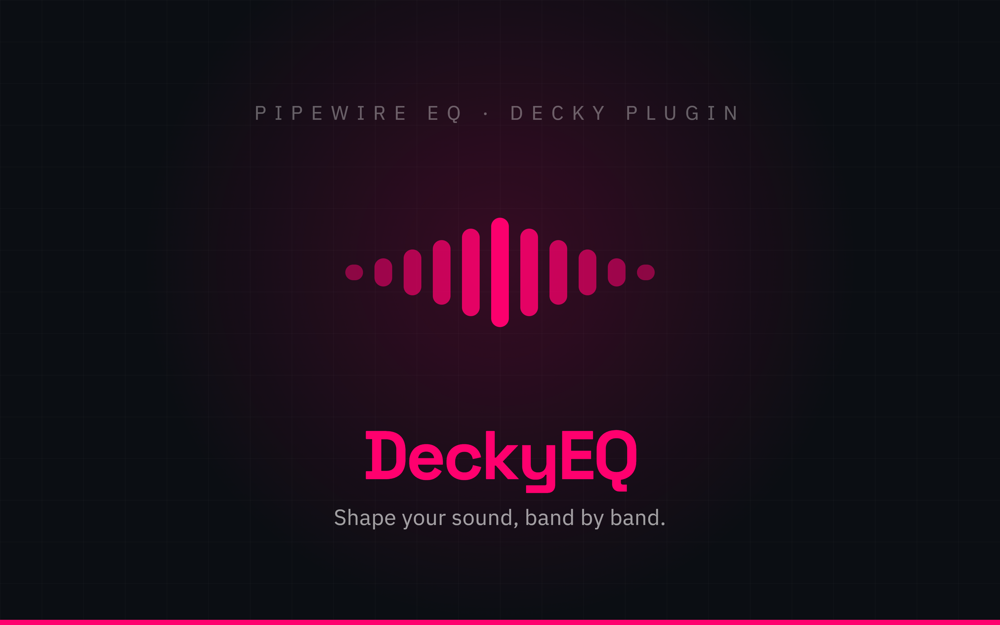
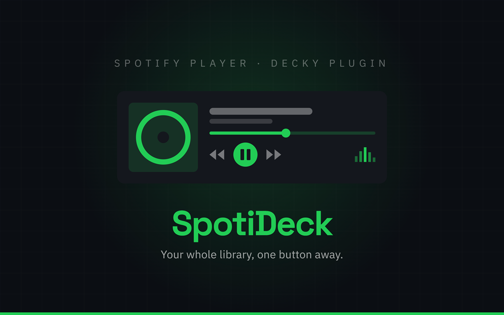
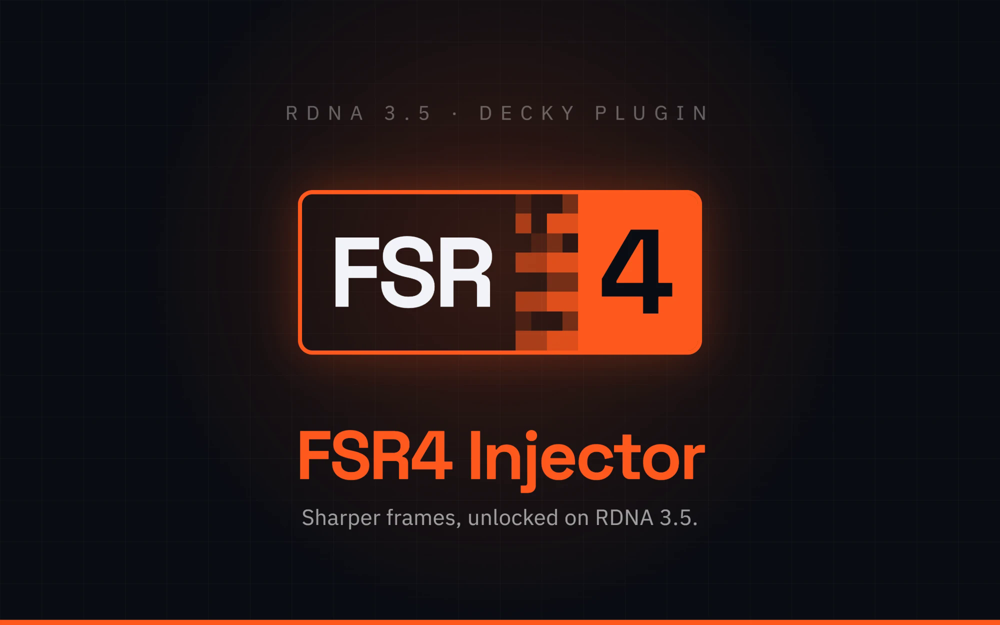

<div align="center">



[](#installation)
[](#plugins)
[](#how-it-works)
[](https://decky.xyz)

**Every Rayek plugin, one store.**
A custom plugin store for [Decky Loader](https://decky.xyz), holding my plugins for the Lenovo Legion Go and AYANEO
handhelds, plus hardware-independent utilities. Add the address once and they install and update through Decky's own
**Store** tab, like anything else.

[Installation](#installation) · [Plugins](#plugins) · [How it works](#how-it-works) · [License](#license)

</div>

---

## Installation

Copy this address:

```
https://decky.rayek.workers.dev
```

On the device, open **Decky → Settings → General → Store channel**, switch it to **Custom**,
and paste the address into the field that appears. The **Store** tab then lists the plugins
below that have a public installation release.

Switching back to **Default** at any time restores the official store. Plugins already
installed from here stay installed.

---

## Plugins

### Legion Go 2 Companion

<div align="center">

<a href="https://github.com/Rayekkk/LegionGo2Companion"></a>

[](https://github.com/Rayekkk/LegionGo2Companion/releases/latest)
[](https://github.com/Rayekkk/LegionGo2Companion/releases)
[](https://github.com/Rayekkk/LegionGo2Companion/blob/main/LICENSE)

</div>

**[Legion Go 2 Companion](https://github.com/Rayekkk/LegionGo2Companion)** brings TDP and CPU profiles, Fan Control with custom curves, battery protection, controller haptics, gyro, controller sleep, lighting, button remapping, controller firmware updates, an HDR brightness fix for games and Wi-Fi controls into one Steam overlay, with the same controls in a Desktop Mode app. It includes the features of LeGoTDP, LeGoVibeControl and the HDR fix from LeGo2BrightnessFix (SteamOS 3.9 handles the rest of the screen natively). Early beta on the Legion Go and Legion Go S.

Uninstall the overlapping standalone plugins before installing Companion: it pauses while they are installed and does not import their settings. See the [migration instructions](https://github.com/Rayekkk/LegionGo2Companion#installation).

---

### AYANEO 3 Companion

<div align="center">

<a href="https://github.com/Rayekkk/Ayaneo3Companion"></a>

[](https://github.com/Rayekkk/Ayaneo3Companion/releases/latest)
[](https://github.com/Rayekkk/Ayaneo3Companion/releases)
[](https://github.com/Rayekkk/Ayaneo3Companion/blob/main/LICENSE)

</div>

**[AYANEO 3 Companion](https://github.com/Rayekkk/Ayaneo3Companion)** brings the handheld's hardware controls into Decky Loader: TDP and CPU profiles, Fan Control with custom curves, vibration, lighting, rear-button bindings with TM Guard, Magic Modules, charge bypass, smart-amplifier audio and OLED display support, all from Game Mode.

---

### DeckyVibranceHDR

<div align="center">

<a href="https://github.com/Rayekkk/DeckyVibranceHDR"></a>

[](https://github.com/Rayekkk/DeckyVibranceHDR/releases/latest)
[](https://github.com/Rayekkk/DeckyVibranceHDR/releases)
[](https://github.com/Rayekkk/DeckyVibranceHDR/blob/main/LICENSE)

</div>

**[DeckyVibranceHDR](https://github.com/Rayekkk/DeckyVibranceHDR)** is saturation control under gamescope, in SDR and HDR alike. Which mapping applies is read from the panel's EDID rather than the model name, so it is not tied to one handheld.

---

### DeckyEQ

<div align="center">

<a href="https://github.com/Rayekkk/DeckyEQ"></a>

[](https://github.com/Rayekkk/DeckyEQ/releases/latest)
[](https://github.com/Rayekkk/DeckyEQ/releases)
[](https://github.com/Rayekkk/DeckyEQ/blob/main/LICENSE)

</div>

**[DeckyEQ](https://github.com/Rayekkk/DeckyEQ)** brings a live ten-band PipeWire equalizer to Gaming Mode, with a full-screen curve editor for touch and controller, bass, treble, stereo width and a volume boost of up to 12 dB kept from clipping by a limiter. Pick a built-in preset (including Legion Go S and Legion Go 2), save up to 64 of your own, give a game its own sound, and import or export sounds as JSON. Steam's volume and output stay untouched. Requires a working PipeWire audio session; no extra effects packages are needed on the tested SteamOS system.

---

### SpotiDeck

<div align="center">

<a href="https://github.com/Rayekkk/SpotiDeck"></a>

[](https://github.com/Rayekkk/SpotiDeck/releases/latest)
[](https://github.com/Rayekkk/SpotiDeck/releases)
[](https://github.com/Rayekkk/SpotiDeck/blob/main/LICENSE)

</div>

**[SpotiDeck](https://github.com/Rayekkk/SpotiDeck)** puts Spotify playback, playlists, albums, podcasts, search and your library in the Steam overlay, with separate music and game audio controls and a game/Spotify balance slider. Requires Spotify Premium and your own Spotify Web API Client ID; local playback also requires a Spotify Soloist API key.

---

### FSR4 Injector

<div align="center">

<a href="https://github.com/Rayekkk/FSR4Injector"></a>

[](https://github.com/Rayekkk/FSR4Injector/releases/latest)
[](https://github.com/Rayekkk/FSR4Injector/releases)
[](https://github.com/Rayekkk/FSR4Injector#license)

</div>

**[FSR4 Injector](https://github.com/Rayekkk/FSR4Injector)** brings AMD's official FSR 4.1 upscaler, with the Lite model made for handhelds, to games that already use FSR 3.1 on RDNA 3.5 handhelds (Radeon 890M) in SteamOS Gaming Mode. Turn it on per game from the Quick Access Menu; AMD's own library is downloaded from AMD and nothing is patched on disk.

---

## How it works

There is no server. `plugins.json` is the entire store: Decky fetches it, parses it as a list
of plugins, and downloads each zip straight from its own GitHub release.

`build_store.py` regenerates the file. It reads `plugin.json` from each plugin repo on GitHub for the
name, author, description and tags, lists published stable releases, and hashes each new
published zip so Decky can verify what it downloaded. Run it after a release and commit the
result. Store artwork is kept in `assets/` and plugin IDs stay stable. Draft and prerelease versions are excluded. **The address never changes.**

```bash
python build_store.py
git commit -am "Refresh the store" && git push
```

The file is served by GitHub Pages from `main`, and `worker.js` fronts it at the address
above. A push takes a minute or so to appear.

<details>
<summary><b>Why a worker in front of GitHub Pages</b></summary>

The worker exists for one reason. Decky adds an `X-Decky-Version` header, which makes the
request non-simple, so the browser sends a `OPTIONS` preflight first and only issues the real
`GET` if the answer names that header. **No static host answers it:** GitHub Pages replies
405, `raw.githubusercontent` 403, and jsDelivr replies 200 but without
`Access-Control-Allow-Headers`, which the browser rejects just the same. A blocked request
leaves the store spinning forever rather than showing an error, because `Store.tsx` has no
`catch` around the fetch.

It also answers `/versions`, which Decky 3.3.1 calls to check installed plugins for updates: there it returns
`{"Plugin name": ["newest version", "sha256"]}` built from the same `plugins.json`, the shape the official store
uses. Without it Decky rejects the answer and never offers an update.

Sorting is the store's job too: the Store tab asks for `?sort_by=name|date|downloads&sort_direction=asc|desc`,
and the worker sorts by the `created` and `downloads` fields `build_store.py` writes (date means the plugin's first
release, as in the official store). Download counts are as of the last run of `build_store.py`.

The worker reads whatever `plugins.json` currently says, so a plugin release never needs it redeployed; only a
change to `worker.js` itself does. `node --test worker.test.mjs` checks it against this repository's `plugins.json`.

</details>

<details>
<summary><b>What <code>plugins.json</code> has to get right</b></summary>

Three details, all handled by the generator:

- **`artifact`** must be present on every version. Without it Decky falls back to the official
  CDN, which does not have these plugins.
- **`hash`** is the SHA-256 of the zip and is verified after download; a mismatch refuses the
  install.
- **`name`** must match `plugin.json` exactly, because that is how Decky matches an installed
  plugin against a store entry when it checks for updates.

</details>

---

## License

The plugins are BSD 3-Clause, with third-party parts under their own terms (for example FSR4 Injector's LGPL-2.1
shim); see each repository for its licence and notices. Not affiliated with Valve,
Lenovo, AYANEO or the Decky Loader team.
